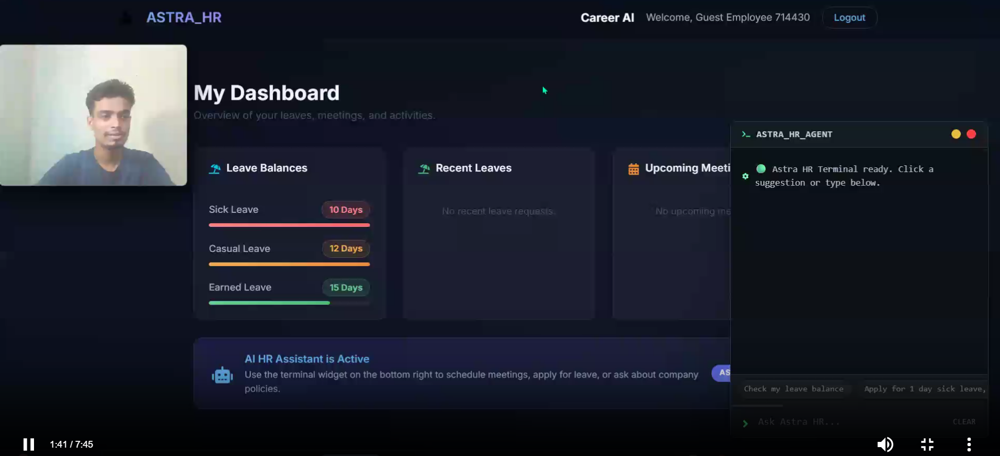
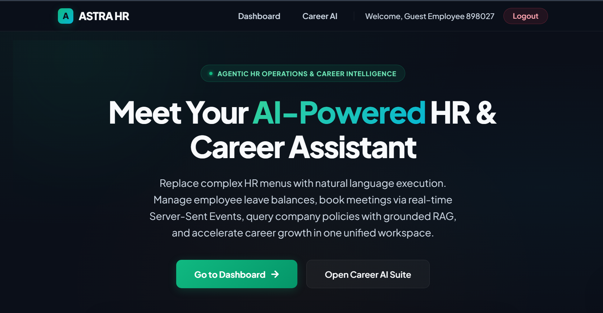

# Astra HR: AI-Powered HR & Career Assistant

---

A full-stack MERN (MongoDB, Express.js, React, Node.js) HR operations and career intelligence platform to manage employee leaves, schedule meetings, query company policies via RAG, and interact with an autonomous AI Assistant through a real-time Server-Sent Events (SSE) terminal widget.

---

## 🎥 Demo Video
Watch a walkthrough (5–7 minutes) of all major features of this app.
Click the preview below to watch the Google Drive walkthrough video 👇

[](https://drive.google.com/file/d/1P1Pq9k4xdWpSpqKXvu17sKcXCCcea0Fw/view?usp=sharing)

---

## Quick Start

```bash
git clone https://github.com/Sourabhpande532/AstraAIs.git
cd AstraAI

# 1. Start Backend Server
cd ai-server
npm install
npm start

# 2. Start Frontend Client (in a new terminal)
cd ../ai-client
npm install
npm run dev
```

---

## Technologies

- **Frontend:** React 19 (Vite), TypeScript, Redux Toolkit, React Router, Bootstrap 5, Custom CSS3 Design System
- **Backend:** Node.js, Express.js (MVC Architecture)
- **Database:** MongoDB & Mongoose
- **Authentication:** Stateless JWT (`jsonwebtoken`) & `bcryptjs`
- **AI & Streaming:** OpenAI / OpenRouter SDK, Server-Sent Events (SSE), Agentic Tool Calling, Retrieval-Augmented Generation (RAG)

---

## Reference



---

## Features

**1. Employee Operations Dashboard**
- Executive KPI summary strip tracking available annual quota (`37` total days), requests, and upcoming syncs
- Visual leave balance progress bars (`Sick: 10d`, `Casual: 12d`, `Earned: 15d`)
- Recent leave request history with status badges (`Approved`, `Pending`, `Rejected`), reasons, and type filters
- Chronological upcoming meetings list with relative date badges (`Today`, `Tomorrow`, `Upcoming`)

**2. Agentic AI HR Terminal Widget (SSE)**
- Draggable, minimizable, responsive terminal interface accessible across all authenticated views
- Real-time streaming execution feedback via Server-Sent Events (SSE)
- Multi-step agentic tool calling (`checkLeaveBalance`, `applyForLeave`, `scheduleMeeting`, `generateInterviewQuestions`)
- Grounded HR Policy RAG engine citing exact sections from the Astra HR Handbook

**3. Career AI Upgrade Suite**
- **Roadmap Generator:** Generates structured month-by-month learning curriculums in strict JSON format
- **Interview Simulator:** Produces role-tailored technical questions with difficulty tiers, time limits, and hints
- **Knowledge Base (RAG):** Answers career and policy questions from a verified internal knowledge base with source citations
- **Agentic Career Planner:** Deconstructs career goals into learning plans, recommended projects, and interview prep

**4. Authentication & Security**
- Employee Sign In and Registration with password hashing and JWT verification
- One-click **Continue as Guest Employee** demo flow with pre-seeded leave quotas

---

## API Reference

### `GET /api/hr/dashboard`
Retrieve authenticated employee profile, leave history, and upcoming meetings.
```json
{
  "user": {
    "_id": "...",
    "name": "Jane Doe",
    "email": "jane@company.com",
    "leaveBalance": { "sick": 10, "casual": 12, "earned": 15 }
  },
  "leaves": [
    { "_id": "...", "type": "sick", "days": 1, "reason": "I have a fever", "status": "approved", "createdAt": "..." }
  ],
  "meetings": [
    { "_id": "...", "title": "Doctor's Appointment", "date": "...", "createdAt": "..." }
  ]
}
```

### `POST /api/auth/login`
Authenticate an existing employee and receive a JWT token.
```json
{
  "_id": "...",
  "name": "Jane Doe",
  "email": "jane@company.com",
  "isGuest": false,
  "leaveBalance": { "sick": 10, "casual": 12, "earned": 15 },
  "token": "..."
}
```

### `POST /api/auth/register`
Register a new employee account.
```json
{
  "_id": "...",
  "name": "Jane Doe",
  "email": "jane@company.com",
  "isGuest": false,
  "leaveBalance": { "sick": 10, "casual": 12, "earned": 15 },
  "token": "..."
}
```

### `POST /api/auth/guest`
Instant login as a pre-seeded guest employee.
```json
{
  "_id": "...",
  "name": "Guest Employee 482910",
  "email": "guest482910@astrahr.com",
  "isGuest": true,
  "leaveBalance": { "sick": 10, "casual": 12, "earned": 15 },
  "token": "..."
}
```

### `POST /api/ai/chat/stream`
Send a natural language command to the Agentic HR Terminal and receive a real-time Server-Sent Events stream.
```json
{ "message": "Apply for 1 day sick leave, I have a fever" }
```
Sample Streaming Events:
```text
event: status
data: {"text": "🔍 Analyzing your request...", "type": "thinking"}

event: plan
data: {"steps": 1, "goal": "Apply 1 day sick leave"}

event: step_start
data: {"step": 1, "function": "applyForLeave", "text": "⚡ Step 1: Calling applyForLeave..."}

event: step_result
data: {"step": 1, "function": "applyForLeave", "success": true, "result": {"days": 1, "type": "sick", "remainingBalance": 9}}

event: done
data: {"reply": "✅ Applied 1 day(s) of sick leave. Remaining: 9 days."}
```

### Career AI Suite Endpoints (`Protected`)
- `POST /api/career/roadmap` — `{ role, skillLevel, timeline }`
- `POST /api/career/interview` — `{ role, experience, skills }`
- `POST /api/career/knowledge` — `{ question }`
- `POST /api/career/planner` — `{ prompt }`

---

## Environment Setup

**Backend (`ai-server/.env`)**
```env
PORT=5001
MONGO_URL=mongodb+srv://<username>:<password>@cluster.mongodb.net/astrahr
FRONTEND_URL=http://localhost:5173
JWT_SECRET=your_jwt_secret_key
OPENAI_API_KEY=your_openai_or_openrouter_api_key
```

**Frontend (`ai-client/.env`)**
```env
VITE_API_URL=http://localhost:5001
```

---

## Available Scripts

**Frontend (`ai-client`)**
- `npm run dev` — Start Vite development server
- `npm run build` — Type-check (`tsc -b`) and build production bundle
- `npm run lint` — Run ESLint across all TypeScript/React files
- `npm run preview` — Preview production build locally

**Backend (`ai-server`)**
- `npm start` — Run Express server with `nodemon`

---

## Contact

For questions or feedback, reach out to [sourabhpande43@gmail.com](mailto:sourabhpande43@gmail.com).
